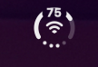
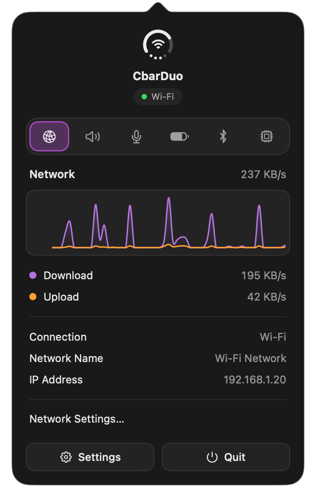
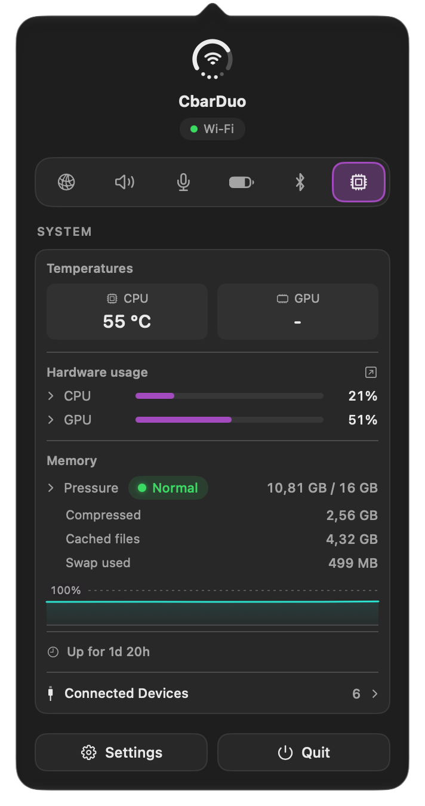

<div align="center">

# CbarDuo

### One compact macOS menu bar indicator for Battery, Network, and Volume.

**Three live states. One glyph. Less menu bar clutter.**

[English](README.md) | [Français](README.fr.md) | [简体中文](README.zh-CN.md) | [Русский](README.ru.md) | [Українська](README.uk.md) | [ไทย](README.th.md)

[**Download CbarDuo 1.4.7**](https://github.com/cojonesnaut/CbarDuo/releases/download/v1.4.7/CbarDuo-1.4.7.dmg) · [**All Releases**](https://github.com/cojonesnaut/CbarDuo/releases) · [**Report a Bug**](https://github.com/cojonesnaut/CbarDuo/issues)

CbarDuo 1.4.7 (Build 16) · macOS 15+ · Apple Silicon only · Free and Open Source

> **Note:** CbarDuo is a fork of [DuoBar](https://github.com/Mikeli7666/DuoBar) by Mikeli7666.

<a href="https://ko-fi.com/duobar"></a>

<br>



</div>

## One glyph, three live states

CbarDuo adapts the iPhone Duo-style three-in-one status concept for the Mac menu bar. One compact glyph presents the system information normally spread across several indicators:

- **Outer arc** → a live Battery Ring on MacBooks, or an Adaptive Ring on desktop Macs
- **Center** → the active network: Wi-Fi, Ethernet, or an offline/fallback state
- **Four lower dots** → live output volume

Persistent status stays monochrome and native-looking. When AirPods or another supported Bluetooth audio output becomes active, the center briefly transitions from Network → AirPods/headphones → Network. Disconnecting does not trigger an animation.

<p align="center">
  
  
</p>

## Adaptive Ring and Battery Ring

On MacBooks, the outer Battery Ring shows live battery level, a dynamic charging bolt, and optional battery color coding for charging, Low Power Mode, and low-battery states. On desktop Macs, Adaptive Ring remains Neutral when there is no meaningful performance activity and automatically surfaces sustained CPU, memory, or thermal pressure when appropriate. It remains automatic: there is no manual metric selector.

## CbarDuo on macOS

The current 1.4.7 release cuts memory use and gives the desktop widget the look of the macOS widgets around it, on top of 1.4.6's French, 1.4.5's new app icon and Turkish, 1.4.4's big cut in CPU and battery use and 1.4.3's redesigned popover with Network, Volume, Mic, Battery, Bluetooth, and System tabs, per-app volume, and system and power stats.

## Features

- Battery Ring with live level, dynamic charging bolt, low-battery state, and optional Battery Color Coding
- Popover battery details: charging, on hold, or running on the adapter, with time remaining until full or empty
- Adaptive Ring for desktop Macs: Neutral by default, with automatic CPU, memory, and thermal pressure awareness
- Refined native Duo visual language, rounded Wi-Fi indicator, Battery Ring, volume indicators, and charging presentation
- Automatic Wi-Fi, Ethernet, and offline network states
- Wi-Fi network name display and public Wi-Fi power control
- Live download and upload speed in the popover’s Network row
- Optional Open on Hover popover behavior
- Four-dot live volume indicator
- Desktop Widget: the same 3-in-1 glyph on your desktop, draggable anywhere, in 3 sizes (turn it on in Settings)
- Compact volume slider, public Core Audio mute, and output-device switching where supported
- Temporary AirPods/headphones connection presentation
- Adjustable menu-bar Icon Size
- English, French, Russian, Ukrainian, Simplified Chinese, Traditional Chinese, Thai, and Turkish
- Compact custom popover: Network and Battery open System Settings, Wi-Fi power, Volume, Audio Output selection, Settings, and Quit
- Liquid Glass popover on macOS 26 and later, with a switch in Settings to bring back the classic pre-1.4.0 look
- Light and Dark Mode
- Launch at Login
- Native Apple Silicon (arm64) build for macOS 15+
- Native Swift, SwiftUI, and AppKit
- Optional Dock icon (off by default); clicking it opens Settings

## Requirements

**macOS 15.0+**<br>
**Apple Silicon (M-series) only**

## Installation

1. Open the [CbarDuo 1.4.7 release](https://github.com/cojonesnaut/CbarDuo/releases/tag/v1.4.7) and find **Assets**.
2. Download **CbarDuo-1.4.7.dmg**. Do not download `Source code (zip)` or `Source code (tar.gz)`.
3. Double-click the DMG and drag **CbarDuo.app** to **Applications**.
4. Open Applications and launch CbarDuo. macOS will say it can't verify the app: open **System Settings → Privacy & Security**, click **Open Anyway** next to CbarDuo, and confirm. CbarDuo is a menu-bar utility and normally does not appear in the Dock.

CbarDuo 1.4.7 is ad-hoc signed and not notarized by Apple, so the first launch needs **Open Anyway** once. Or skip that step: after copying CbarDuo to Applications, run this in Terminal, then open CbarDuo normally:

```bash
xattr -dr com.apple.quarantine /Applications/CbarDuo.app
```

It removes the download flag from CbarDuo only. You don't need `sudo`, or to disable Gatekeeper or SIP.

SHA-256: `06c58033d0a1a6dd5def9a2858ac460f1fb52aa5a7c1b255b36c8381b95bd630`

Build and compatibility/reliability work was checked using Xcode 27 and the macOS 27 SDK with macOS 15 as the minimum. This does not claim macOS 27 hardware validation.

## Permissions

- **Location:** macOS may require authorization before CoreWLAN can expose the current Wi-Fi network name. Denying access does not break basic connection, interface, or signal state; the SSID may simply remain unavailable. CbarDuo requests SSID access only when it is useful to the interface.
- **Bluetooth:** CbarDuo retains public Bluetooth controller observation while Core Audio provides the primary source for Bluetooth audio endpoints. The app does not manage or pair devices.

## Audio output behavior

Volume control is available only when the active Core Audio output exposes software-settable public volume properties. HDMI, AirPlay, USB, and other external outputs may instead display **Controlled by device**.

AirPods and Bluetooth audio classification is best-effort using public system metadata. CbarDuo does not claim exact AirPods generation detection.

## Privacy

- System-status processing occurs locally.
- No analytics or tracking.
- No backend or telemetry.
- No system-status uploads.
- No unrelated network requests.

## Known limitations

- The Wi-Fi network name may be unavailable without Location permission or when macOS withholds it.
- Wi-Fi strength uses documented RSSI data and broad signal ranges; it does not reproduce Apple's private icon algorithm.
- Some audio devices expose fixed or externally controlled volume.
- CbarDuo does not join Wi-Fi networks or pair Bluetooth devices.
- Bluetooth audio and AirPods family detection is best-effort through public APIs.

## Build from source

Open `CbarDuo.xcodeproj` in Xcode, select the **CbarDuo** scheme, and run. Debug builds include status simulation and marketing-capture tools; those tools are excluded from Release behavior.

## Disclaimer

CbarDuo is an independent project and is not affiliated with or endorsed by Apple Inc.

## License

CbarDuo is available under the [MIT License](LICENSE).
