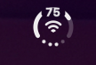
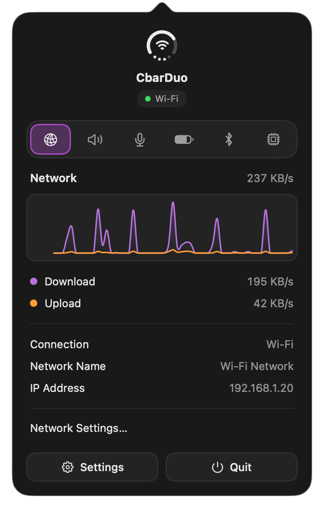
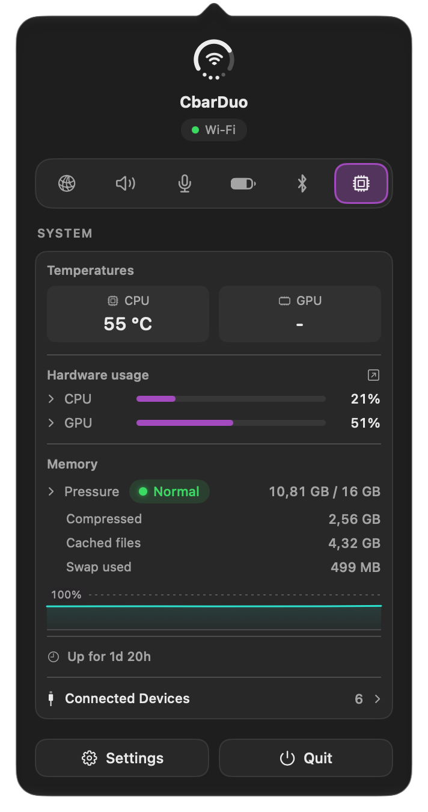

# CbarDuo

[English](README.md) | [Français](README.fr.md) | [简体中文](README.zh-CN.md) | [Русский](README.ru.md) | [Українська](README.uk.md) | [ไทย](README.th.md)

Индикатор в стиле iPhone Duo для строки меню macOS: батарея, сеть и громкость в одном значке.

[**Скачать CbarDuo 1.4.7**](https://github.com/cojonesnaut/CbarDuo/releases/download/v1.4.7/CbarDuo-1.4.7.dmg) · [Все версии](https://github.com/cojonesnaut/CbarDuo/releases) · [English](README.md)

CbarDuo 1.4.7 (сборка 16) · macOS 15 Sequoia или новее · только Apple Silicon

> **Примечание:** CbarDuo — это форк [DuoBar](https://github.com/Mikeli7666/DuoBar) от Mikeli7666.

<p align="center">
  <a href="https://ko-fi.com/duobar"></a>
</p>

<p align="center">
  
</p>

## Скачивание и установка

### Шаг 1. Скачать CbarDuo

Нажмите «Скачать CbarDuo 1.4.7» выше. Браузер загрузит файл:

`CbarDuo-1.4.7.dmg`

Обычному пользователю нужен только этот DMG. Не скачивайте:

- Source code (zip)
- Source code (tar.gz)

Это исходники для разработчиков, а не установщик.

Если вы открыли страницу [Releases](https://github.com/cojonesnaut/CbarDuo/releases):

1. Найдите последнюю версию **CbarDuo 1.4.7**.
2. Внизу страницы откройте список **Assets**.
3. Скачайте **CbarDuo-1.4.7.dmg**.

### Шаг 2. Установить

1. Дважды щёлкните `CbarDuo-1.4.7.dmg`.
2. Finder откроет окно образа диска.
3. Перетащите `CbarDuo.app` в папку **Программы / Applications**.
4. Дождитесь окончания копирования.
5. Откройте «Программы».
6. Запустите CbarDuo.

### Шаг 3. Первый запуск

CbarDuo 1.4.7 подписан ad-hoc и не проходил нотариальную проверку Apple. При первом запуске macOS сообщит, что не может проверить приложение: откройте **Системные настройки → Конфиденциальность и безопасность**, нажмите **Все равно открыть** рядом с CbarDuo и подтвердите. Это нужно сделать один раз.

Или пропустите этот шаг: после копирования CbarDuo в «Программы» выполните в Терминале команду ниже и откройте CbarDuo как обычно:

```bash
xattr -dr com.apple.quarantine /Applications/CbarDuo.app
```

Она снимает отметку о загрузке только с CbarDuo. `sudo` не нужен, отключать Gatekeeper или SIP тоже не нужно.

CbarDuo живёт в строке меню и **по умолчанию не появляется в Dock** (необязательный значок Dock включается в настройках; щелчок по нему открывает настройки). После запуска смотрите на верхний край экрана — значок CbarDuo будет там.

## Зачем доступ к геолокации?

macOS может запросить доступ к геолокации, чтобы показать имя текущей сети Wi‑Fi (SSID). CbarDuo использует это разрешение только через публичные API и только ради имени сети.

Если отказать:

- CbarDuo продолжит работать
- батарея не пострадает
- громкость не пострадает
- базовое состояние сети по-прежнему видно
- имя Wi‑Fi может отображаться как «Имя сети недоступно»

## Как пользоваться

CbarDuo постоянно в строке меню. Три части значка:

- **Внешняя дуга** → батарея / Adaptive Ring
- **Центр** → Wi‑Fi, Ethernet или другое состояние сети
- **Четыре точки снизу** → громкость

Нажмите на значок, чтобы открыть панель:

- Сеть
- Громкость
- Аккумулятор
- Аудиовыход
- Настройки
- Выйти из CbarDuo

В настройках можно включить **Open on Hover** (открывать при наведении).

<p align="center">
  
  
</p>

## Возможности

- Battery Ring: заряд, состояние зарядки, динамическая молния и опциональная цветовая индикация
- Сведения о батарее на панели: зарядка, пауза зарядки или работа от адаптера, а также оставшееся время до полной зарядки или разрядки
- Adaptive Ring: на настольных Mac остаётся Neutral при отсутствии заметной нагрузки и автоматически показывает нагрузку на CPU, память или тепловое состояние при необходимости
- Скруглённый индикатор Wi‑Fi и визуальный язык Duo
- Имя текущей сети Wi‑Fi (SSID)
- Текущая скорость загрузки и отдачи в строке сети на панели
- Включение и выключение Wi‑Fi прямо в CbarDuo
- Состояния Wi‑Fi, Ethernet и офлайн
- Громкость, слайдер и отключение звука (если устройство это поддерживает)
- Сведения об аудиовыходе
- Краткое отображение AirPods / наушников при подключении
- Панель Liquid Glass в macOS 26 и новее (можно отключить в настройках и вернуть классический вид)
- Виджет рабочего стола: тот же значок 3-в-1 на рабочем столе, перетаскиваемый, в 3 размерах
- Необязательный значок в Dock (по умолчанию выключен)
- Open on Hover (открывать при наведении)
- Настраиваемый размер значка в строке меню
- English, французский, русский, украинский, 简体中文, 繁體中文, тайский, турецкий

## Системные требования

- macOS 15 Sequoia или новее
- Только Apple Silicon (чипы M-серии)

## Безопасность и приватность

CbarDuo 1.4.7 подписан ad-hoc и не нотаризован Apple. Приложение не распространяется через Mac App Store.

Состояние системы обрабатывается локально:

- нет аналитики и трекинга
- нет телеметрии
- состояние системы никуда не загружается
- нет посторонних сетевых запросов

CbarDuo — независимый проект и не связан с Apple Inc.

## Если что-то не так

Напишите в [GitHub Issues](https://github.com/cojonesnaut/CbarDuo/issues).

Если вы не технарь, достаточно:

- модели Mac
- версии macOS
- версии CbarDuo
- описания проблемы
- скриншота, если удобно

Технические логи не обязательны.

## Целостность загрузки

SHA-256 официального DMG CbarDuo 1.4.7:

`06c58033d0a1a6dd5def9a2858ac460f1fb52aa5a7c1b255b36c8381b95bd630`

Обычному пользователю это проверять не нужно. Строка для тех, кто хочет убедиться, что файл не подменили.

## Совместимость

- macOS 15.0 или новее
- Только Apple Silicon (arm64)
- Сборка и работы по совместимости/надёжности выполнены с Xcode 27 и SDK macOS 27 с минимальной версией macOS 15. Это не заявление о завершённом тестировании macOS 27 на реальном оборудовании.

В панели CbarDuo доступны переключение аудиовыхода и быстрые переходы к настройкам Network, Battery и Sound.

## Лицензия

CbarDuo распространяется под [MIT License](LICENSE).
